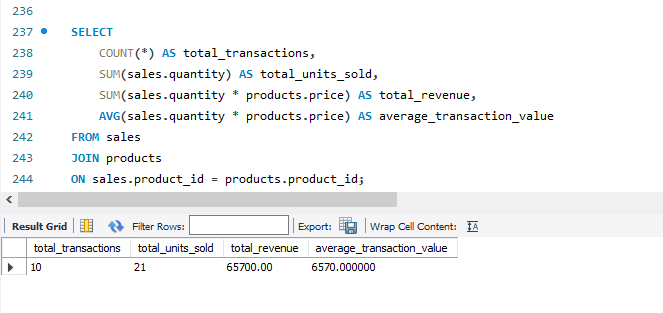
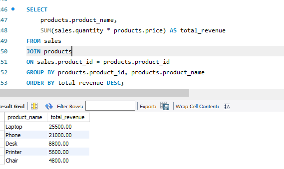

# SQL Sales Analysis Project

## Project Overview

This project analyzes retail sales data using MySQL to answer real business questions and identify sales performance trends.

The project uses a fictional retail company operating in Zambia, with customers from Lusaka, Ndola, Kitwe, and Livingstone.

## Project Objectives

- Calculate total sales revenue.
- Identify the highest-revenue products.
- Analyze sales performance by city.
- Identify the highest-spending customers.
- Calculate average transaction value.
- Use SQL to support business decision-making.

## Tools Used

- MySQL Server 8.0
- MySQL Workbench
- SQL

## SQL Skills Demonstrated

- SELECT and WHERE
- ORDER BY
- GROUP BY and HAVING
- COUNT, SUM, AVG, MIN, MAX
- INNER JOIN
- Subqueries
- Primary Keys and Foreign Keys

## Database Structure

The database contains three connected tables:

1. **customers** — Customer IDs, names, and cities.
2. **products** — Product IDs, names, categories, and prices.
3. **sales** — Transaction IDs, customers, products, quantities, and dates.

## Key Business Findings

| Metric | Result |
|---|---|
| Total Revenue | K65,700 |
| Total Transactions | 10 |
| Total Units Sold | 21 |
| Average Transaction Value | K6,570 |
| Highest-Revenue Product | Laptop — K25,500 |
| Highest-Revenue City | Lusaka — K30,300 |
| Highest-Spending Customer | John Banda — K20,500 |

## Business Recommendations

1. Investigate opportunities to increase laptop and phone sales, as these generate the highest revenue.
2. Study Lusaka's customer demand to understand its strong revenue performance.
3. Explore ways to improve sales of lower-revenue products.
4. Consider customer loyalty initiatives to encourage repeat purchases.

These findings are based on a small fictional dataset and should not be treated as evidence of real market performance.

## Conclusion

This project demonstrates practical SQL skills in data retrieval, filtering, aggregation, table relationships, and business reporting.

It forms part of my Data Analyst portfolio and demonstrates how SQL can transform transaction data into useful business insights.

## Author

Bester Malama

Aspiring Data Analyst | Lusaka, Zambia

## SQL Analysis Screenshots

### 1. Total Sales Revenue

### 2. Sales Revenue by Product

### 3. Sales Revenue by City

### 4. Top Customers

### 5. HAVING Analysis

### 6. Subquery Analysis

### 7. Database Tables

